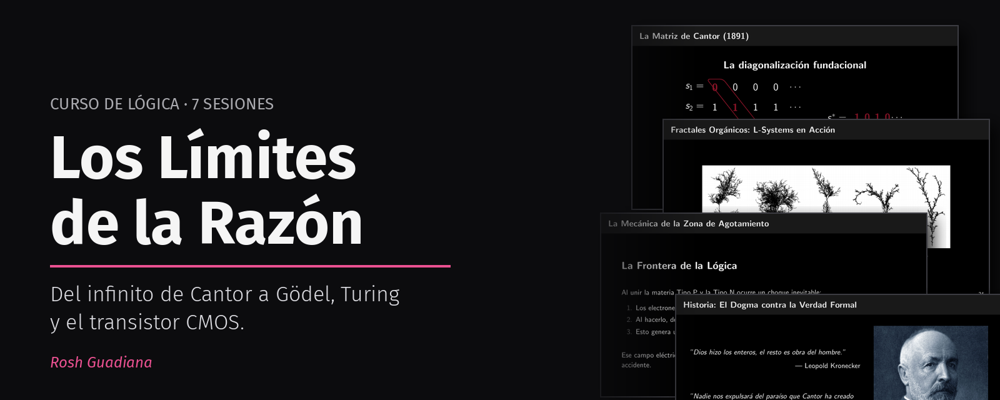
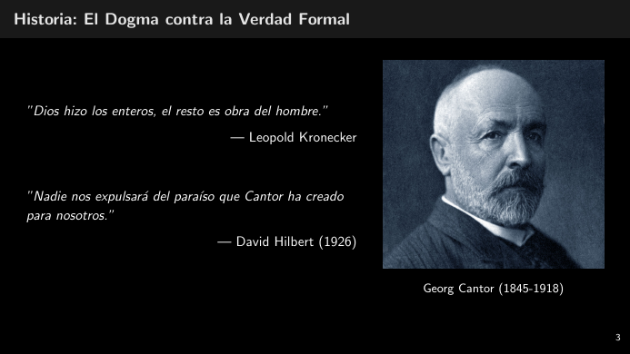
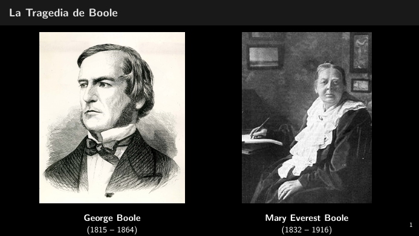
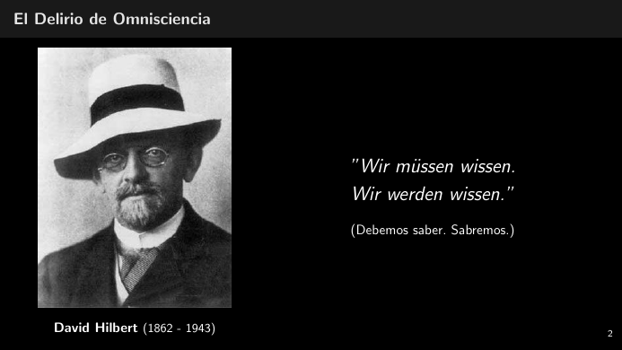
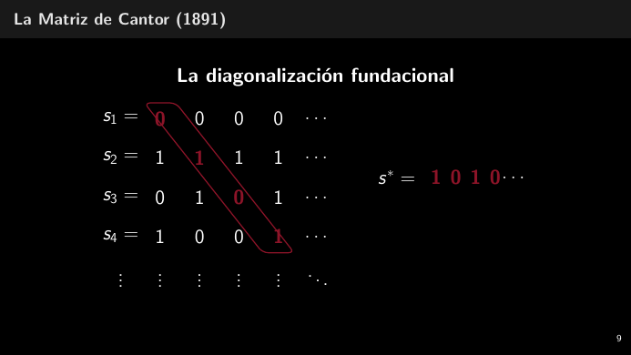
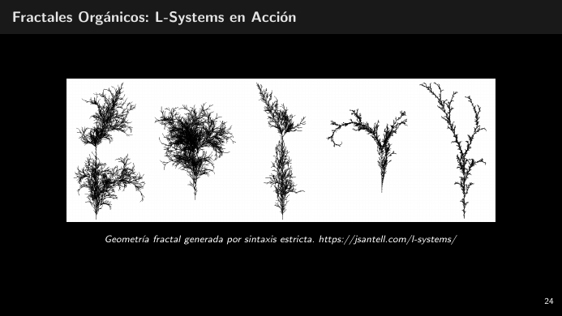
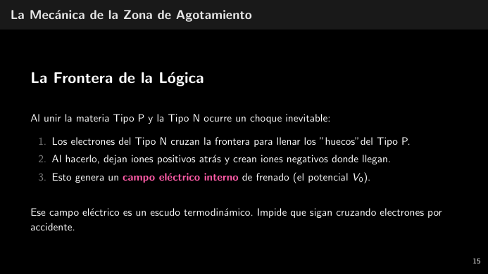
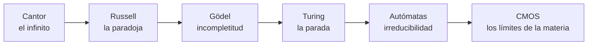

<p align="center">
  
</p>

<p align="center">
  <a href="#slides"></a>
  <a href="logic/syllabus/syll.pdf"></a>
  <a href="logic/studyMap/roadm.pdf"></a>
  <a href="#demos-en-python"></a>
</p>

<p align="center">
  <b>Español</b> · <a href="#english">English</a>
</p>

---

**Los Límites de la Razón** es un ciclo de clases entre pares sobre lógica y sus límites. Arranca con una pregunta sencilla, *¿qué significa contar?*, y llega a los resultados que pusieron un techo a las matemáticas y a la computación: la diagonal de Cantor, la paradoja de Russell, la incompletitud de Gödel y el problema de la parada de Turing. Al final, la lógica vuelve a la materia: autómatas celulares, teoría de la información y cómo el silicio termina ejecutando álgebra booleana.

Todo está en el repo: **slides en PDF listas para ver**, el código fuente en LaTeX (Beamer) y demos interactivas en Python.

## Slides

> Haz clic en cualquier imagen o título para abrir el PDF directamente en GitHub.

<table>
  <tr>
    <td width="50%" valign="top">
      <a href="logic/slides/1/S1.pdf"></a>
      <h3><a href="logic/slides/1/S1.pdf">1 · Conjuntos y el Infinito</a></h3>
      Equipolencia, jerarquías del infinito, el argumento diagonal (1891), la paradoja de Russell y la reconstrucción con ZF.
    </td>
    <td width="50%" valign="top">
      <a href="logic/slides/2/S2.pdf"></a>
      <h3><a href="logic/slides/2/S2.pdf">2 · Lógica Proposicional</a></h3>
      Boole, el sistema MIU, forma vs. fondo, sintaxis y semántica, teoría de la demostración y completitud funcional (NAND).
    </td>
  </tr>
  <tr>
    <td width="50%" valign="top">
      <a href="logic/slides/3/S3.pdf"></a>
      <h3><a href="logic/slides/3/S3.pdf">3 · Primer Orden y Teoría de Modelos</a></h3>
      La crisis de los fundamentos, el programa de Hilbert, cuantificadores, firmas lógicas, estructuras y el teorema de completitud.
    </td>
    <td width="50%" valign="top">
      <a href="logic/slides/4/S4.pdf"></a>
      <h3><a href="logic/slides/4/S4.pdf">4 · Peano, Gödel y Turing</a></h3>
      <i>Principia Mathematica</i>, aritmética de Peano, números de Gödel, la oración <i>G</i>, la incompletitud (1931) y el problema de la parada.
    </td>
  </tr>
  <tr>
    <td width="50%" valign="top">
      <a href="logic/slides/6/S6.pdf"></a>
      <h3><a href="logic/slides/6/S6.pdf">6 · Autómatas e Información</a></h3>
      Shannon, autómatas finitos y celulares, la Regla 30, caos e irreducibilidad, el Juego de la Vida, L-Systems y entropía.
    </td>
    <td width="50%" valign="top">
      <a href="logic/slides/7/S7.pdf"></a>
      <h3><a href="logic/slides/7/S7.pdf">7 · Termodinámica de la Lógica</a></h3>
      Ruido térmico, semiconductores, la unión PN, el transistor de Bell Labs, MOSFET, CMOS y las compuertas NAND en silicio.
    </td>
  </tr>
</table>

> **¿Y la sesión 5?** No tiene slides a propósito: es un diálogo peripatético al aire libre, sin salón ni pizarrón, sobre lo que implica la Sesión 4. Está descrita en el [syllabus](logic/syllabus/syll.pdf).

### Material de apoyo

| Documento | Qué contiene |
|---|---|
| [**Syllabus**](logic/syllabus/syll.pdf) | El arco narrativo del curso: objetivos, contenido de cada sesión y bibliografía. |
| [**Plan de estudio**](logic/studyMap/roadm.pdf) | Un roadmap intensivo de 10 días para estudiar el material por tu cuenta. |

## El hilo rojo

Hay una sola idea, la **diagonalización**, que recorre todo el curso:



## Demos en Python

La Sesión 6 incluye simulaciones que se corren en vivo durante la clase:

| Script | Qué muestra |
|---|---|
| [`simpleautomaton.py`](logic/slides/6/simpleautomaton.py) | La Regla 30 en la terminal, sin dependencias. |
| [`automatonUI.py`](logic/slides/6/automatonUI.py) | La Regla 30 animada e interactiva. |
| [`life-game.py`](logic/slides/6/life-game.py) | El Juego de la Vida de Conway sobre un toro. |
| [`lsystems/`](https://github.com/zac-garby/lsystems) | L-Systems (submódulo de [zac-garby/lsystems](https://github.com/zac-garby/lsystems)). |

```bash
git clone --recursive https://github.com/RoshTzsche/logic_lectures.git
cd logic_lectures
pip install -r requirements.txt

python logic/slides/6/simpleautomaton.py
python logic/slides/6/automatonUI.py
python logic/slides/6/life-game.py
```

## Estructura

```
logic/
├── slides/        # una carpeta por sesión: SN.tex + SN.pdf (+ demos)
├── syllabus/      # syllabus del curso
├── studyMap/      # plan de estudio de 10 días
├── assets/        # imágenes que usan las slides
└── lsystems/      # submódulo con el generador de L-Systems
docs/img/          # imágenes del README
```

## Compilar desde el código fuente

Los PDF ya están compilados, así que solo necesitas esto si quieres modificar las slides. Usan `beamer` con el tema `metropolis` y el esquema de colores `owl`. Paquetes principales: `babel`, `inputenc`, `amsfonts`, `amsmath`, `amssymb`, `amsthm`, `graphicx` y `tikz`.

```bash
cd logic/slides/1
latexmk -pdf S1.tex   # o pdflatex dos veces
```

---

## English

**The Limits of Reason** is a peer-taught lecture series (in Spanish) on logic and its limits. It starts from a simple question, *what does it mean to count?*, and builds up to the results that put a ceiling on mathematics and computation: Cantor's diagonal argument, Russell's paradox, Gödel's incompleteness theorems and Turing's halting problem. It then brings logic back down to matter with cellular automata, information theory and how silicon ends up running Boolean algebra.

- **Slides (PDF):** [1 · Sets & Infinity](logic/slides/1/S1.pdf) · [2 · Propositional Logic](logic/slides/2/S2.pdf) · [3 · First-Order Logic](logic/slides/3/S3.pdf) · [4 · Peano, Gödel & Turing](logic/slides/4/S4.pdf) · [6 · Automata & Information](logic/slides/6/S6.pdf) · [7 · The Thermodynamics of Logic](logic/slides/7/S7.pdf)
- **Session 5** has no slides on purpose: it is an outdoor, open discussion.
- **Course docs:** [Syllabus](logic/syllabus/syll.pdf) · [10-day study plan](logic/studyMap/roadm.pdf)
- **Python demos:** see [Demos en Python](#demos-en-python) above (Rule 30, Game of Life, L-Systems).
- **Building:** Beamer with the `metropolis` theme and `owl` color scheme; the compiled PDFs are already in the repo.
